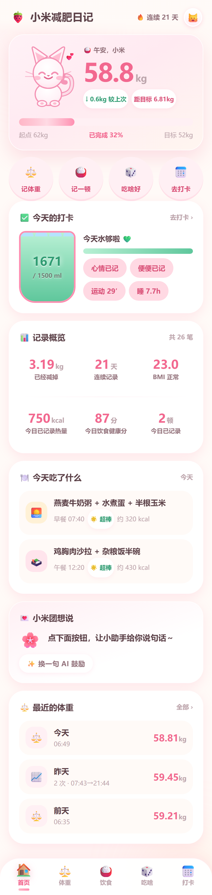
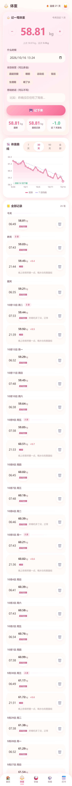
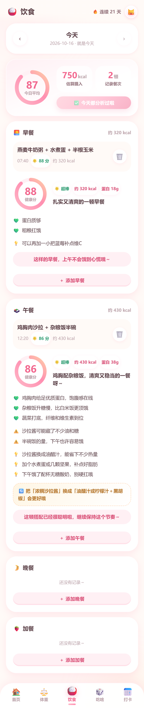
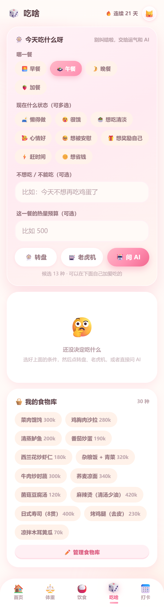
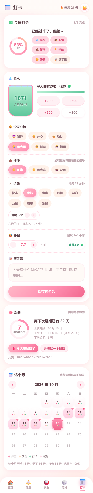
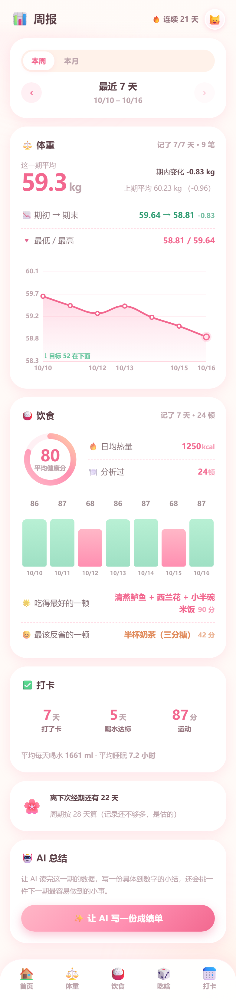
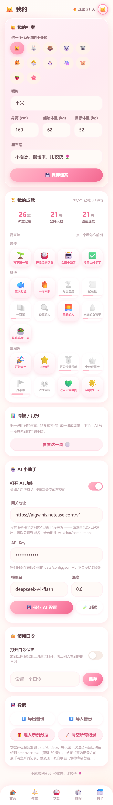
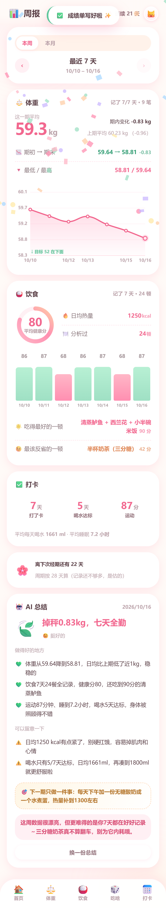
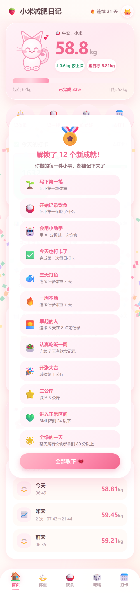

# 小米减肥日记

一个 Q 萌的减脂记录小站。草莓牛奶粉配色、会呼吸的粉色小猫吉祥物、每一步操作都有动画反馈。

前后端一体：`node server/index.mjs` 就能跑，**零第三方依赖**，不需要 `npm install`。

## 长这样

下面都是按手机视口（390 × 844）截的，跟实际用起来的比例一致。

| 首页 | 体重 |
|---|---|
|  |  |

| 饮食 | 今天吃什么 |
|---|---|
|  |  |

| 每日打卡 | 周报 |
|---|---|
|  |  |



---

## 快速开始

```bash
node server/index.mjs
# 然后浏览器打开 http://localhost:4321
```

Windows 上双击 `启动.bat` 也行，Linux/macOS 用 `./start.sh`。

第一次打开是干干净净的一张白纸，跟着页面上的提示记第一笔就好。

想先看看长什么样、或者想试着玩一下，去 **我的 → 数据 → 🎁 灌入示例数据**，
会灌进 20 天的体重曲线和几天的饮食记录（带 AI 分析结果）；
想正式开始记录时点旁边的 **🧹 清空所有记录**，就变回白纸了（食物库会留着）。

> 现在这个工作区里的 `data/db.json` 已经灌好示例数据了，打开就能看到完整效果。

### 环境要求

只要 Node.js **20 或更新**（跑在 24 上开发）。没有数据库、没有构建步骤、没有 npm 依赖。

---

## 已实现的功能

### ⚖️ 体重记录
- 一天可以记很多次，每条带时间戳，自动按天分组
- 同一天多次记录会显示 `2 次 · 07:43 → 21:44`，相邻两次之间的增减单独标出来
- 状态标签（晨起空腹 / 睡前 / 运动后 / 饭后 / 生理期 / 喝了水）+ 一句备注
- 曲线图：7 / 30 / 90 天 / 全部可切换，带 7 日均线、目标线、触摸显示具体数值
- 自动算：已减多少、距目标还差多少、完成百分比、BMI、连续记录天数、近 7 天趋势
- **每减掉 1 公斤自动撒花庆祝**，破历史新低也会单独庆祝

### 🍚 饮食记录
- 按早 / 午 / 晚 / 加餐分开记，可切换日期补记
- 从食物库点一下就加进当天的记录
- **AI 分析**：健康分（0–100）、热量和蛋白质估算、做得好的地方、需要注意的地方、
  下一顿怎么调、"把 X 换成 Y" 的具体替换建议、一句鼓励
- 一天可以一键批量分析，平均分 ≥ 80 会撒花
- 当天汇总：估算总热量、平均健康分、记录了几顿

### 🎲 今天吃什么
纠结星人专用，三种玩法：
- **🎡 转盘**：按权重抽（常吃的更容易被抽到），转 4.6 秒后指针停在结果上
- **🎰 老虎机**：滚轮减速停在某一个上
- **🤖 问 AI**：带上你的状态（懒得做 / 很饿 / 想被安慰 / 想奖励自己 / 赶时间 / 想省钱…）、
  忌口和热量预算，让它给 3 个推荐 + 搭配建议 + 今天该避开什么

结果可以直接"就吃这个"，一键记进当天的饮食。食物库可以自己加、删。

### ✅ 每日打卡 + 月历
- 喝水：一只会涨的水杯，+200 / +300 / +500 一次一点，喝满 1500ml 撒花；顶上有会走的水波
- 心情（6 种）、便便（3 种）、运动（8 种，默认 30 分钟，可 ±10 分钟微调）、睡眠（0.5 小时一档）
- 随手记一句话
- 顶部一个圆环显示今天 6 项完成了几项，每记一样就更新
- **月历视图**：每一天用小圆点标出"记了体重 / 记了饮食 / 打了卡"，经期那几天标 🌸
- 点某一天弹出那天的全部记录，还能一键跳去补记

### 🌸 经期记录与体重波动提醒
- 记一次"今天来经期了"就能开始推算；点"今天结束了"记下经期长度
- 自动算：月经周期长度、经期第几天、下次预计哪天来、还有几天
- **体重上涨时，如果正好在经期里或经期前 3 天，首页会主动告诉她
  "这 0.5kg 很可能是经前水肿，别被秤吓到"** —— 反过来，经期刚结束那几天
  上涨是不会拿经期当借口的，免得给一个错的安慰
- 周期长度用的是相邻两次**开始日**的间隔，所以即使最近一次忘了点"结束了"，
  也照样能算出来

### 📊 周报 / 月报 + AI 总结
- 本周 / 本月切换，可以一页页往前翻
- 体重：这一期平均、期初→期末变化、跟上期比、最低/最高，加一条曲线
- 饮食：平均健康分（带圆环）、日均热量、每天一根分数柱（<85 粉、≥85 绿）、
  吃得最好的一顿、最该反省的一顿
- 打卡：打了几天的卡、喝水达标几天、运动多少分钟、平均喝水和睡眠
- **✨ 让 AI 写一份成绩单**：读完这一期的真实数字，给一个标题、一句心情定位、
  做得好的地方、可以留意的地方，以及"下一期只做一件事"。提示词里明确禁止
  身材羞辱、极端低热量和断食建议，并且会解释经期前后的水分波动
- 这一期完全没有记录时，不显示空表格，而是一句"记录断了也没关系，回来就好"

AI 总结长这样（下面这张是接真实网关跑出来的，点一下"让 AI 写一份成绩单"就有了）：



### 🏆 成就体系（21 个勋章）
- 分三组：起步 / 坚持 / 里程碑
- 没解锁的勋章是灰的，下面带一条进度条（比如"月度全勤 21/30"），
  点一下能看到还差多少
- 解锁时会撒花 + 弹窗；**一次解锁 3 个以上会打包成一个弹窗**，
  免得连弹十几次。列表里的勋章错峰出现，可以一个个看，也能"全部收下 🎀"
  一次收掉；1~2 个则单独飘一张小卡片



---

## AI 网关怎么配

去 **我的 → AI 小助手**：

| 字段 | 说明 |
|---|---|
| 打开 AI 功能 | 总开关 |
| 网关地址 | 兼容 OpenAI 格式的地址。可以只填到域名（`https://api.deepseek.com`），会自动补 `/v1/chat/completions`；也可以直接填完整路径 |
| API Key | 只写进服务器的 `data/config.json`，**永远不会发给浏览器** |
| 模型名 | 比如 `deepseek-chat`、`gpt-4o-mini`、`qwen-plus` |
| 温度 | 默认 0.6，分析类任务建议 0.3–0.7 |

填完点 **🧪 测试**，通了会告诉你模型名和它的回复。

> **网关只有服务器能访问也没关系。** 所有 AI 请求都由后端代理发出，
> 浏览器只和自己的服务器通信。这也是为什么密钥不会泄露到前端。

### 如果用的是"会思考"的模型

`deepseek-reasoner`、`deepseek-v4-flash` 这类模型会先输出一段思考
（响应里的 `reasoning_content`）再给答案，**思考也占 token**。
所以 `max_tokens` 给小了会出两种很像"网关坏了"其实不是的现象：

- `content` 是空的、`finish_reason` 是 `length` —— token 全花在思考上了
- 看着像正常的 JSON，但断在半句，解析不出来

代码里已经处理了：报错时这两种情况会分别说清楚（"还没写完就被截断了" /
"只吐了思考过程"），不会混成一句"AI 网关没有返回内容"；
`server/ai.mjs` 里每个 JSON 调用也都显式给了够用的 `max_tokens`。

**换成别的推理模型时，留意 `max_tokens` 别小于 2000**，不然很容易被截断。

---

## 放到服务器上

直接跑：

```bash
PORT=8080 node server/index.mjs
```

`PORT` 和 `HOST` 都支持环境变量，默认 `0.0.0.0:4321`。

**强烈建议先打开口令保护**：我的 → 访问口令 → 打开口令保护，设一个口令。
这个站没有多用户体系，口令只是防止别人误闯你的日记，**别用你的重要密码**。

### systemd（Linux 服务器）

```bash
sudo cp deploy/mi-diary.service /etc/systemd/system/
sudo systemctl daemon-reload
sudo systemctl enable --now mi-diary
```

改一下 unit 文件里的路径和用户再复制。

### Docker

```bash
docker build -t mi-diary .
docker run -d --name mi-diary -p 4321:4321 -v "$PWD/data:/app/data" mi-diary
```

---

## 数据存在哪

```
data/
  db.json          所有记录（体重、饮食、每日打卡、经期、成就、食物库、档案）
  config.json      AI 网关配置和口令 —— 里面有密钥，别提交到 git
  backups/
    db-YYYY-MM-DD.json   每天第一次改动前自动备份，保留最近 30 天
```

**备份就是拷 `data/` 这一个目录。**
也可以在界面里 **我的 → 数据 → 导出备份** 下载一个 JSON，导入时可选合并或覆盖。

写入用的是"先写临时文件再改名"的原子写，断电不会把 `db.json` 写坏；
真写坏了也会把坏文件另存一份再退回默认值，不会直接丢数据。

---

## 代码结构

```
server/
  index.mjs      HTTP 服务：静态文件 + REST API + 每个接口的处理
  store.mjs      JSON 读写、默认数据、每日备份
  metrics.mjs    统计、成就、周报、经期推算
  ai.mjs         AI 网关代理 + 提示词 + 容错 JSON 解析
  demo.mjs       示例数据生成器
  paths.mjs      路径和端口配置
public/
  index.html
  css/style.css       设计系统（颜色、圆角、阴影、组件）
  css/animations.css  所有关键帧动画
  js/app.js           启动、登录、外壳、路由、成就庆祝
  js/api.js           后端接口封装
  js/router.js        路由表和导航项
  js/state.js         全局状态
  js/ui.js            吐司 / 抽屉 / 弹窗 / 撒花 / 数字滚动
  js/utils.js         模板字符串（默认转义）、日期、常量
  js/period.js        经期推算（跟 server/metrics.mjs 同一套口径）
  js/mascot.js        吉祥物 SVG（按进度和趋势换表情）
  js/chart.js         体重曲线 canvas 绘制
  js/components.js    健康分环、分析结果块
  js/views/*.js       七个页面
scripts/
  check-imports.mjs   静态检查：有没有 import 不存在的导出
  render-check.mjs    DOM 替身把所有页面跑一遍，顺带查 HTML 有没有被转义坏
  state-check.mjs     平时走不到的渲染分支（水肿提醒、AI 总结结果块）
  period-check.mjs    经期推算的回归检查（前后端口径 + 水肿提醒该不该出现）
  shot.mjs            按真实手机视口给所有页面截图（走 CDP）
```

### 开发时

```bash
npm run dev              # node --watch，改后端自动重启
npm run check            # 导入检查 + 经期推算检查，不用起后端
npm run check:render     # 页面渲染检查，需要先起后端
npm run shots            # 手机视口截图到 docs/screenshots/，需要先起后端
```

`render-check.mjs` 会用一个极简 DOM 替身把七个页面的 `render()` 真跑一遍，
检查有没有 `undefined` / `NaN` / `[object Object]` 漏进 HTML、标签是否配平、
HTML 有没有被二次转义成文字，以及每个页面该出现的关键内容在不在。

`state-check.mjs` 补的是那些**平时走不到**的渲染分支——正因为只在特定条件下
出现，最容易悄悄坏掉：经期水肿提醒卡片（要正好在易水肿窗口里 + 最近确实涨秤）、
以及 AI 总结的结果块（要有能用的网关）。它会把 `/api/report/summary` 的响应
拦下来伪造一份，然后真的触发按钮的 `onclick`，把渲染结果逐条断言。
加上 `DUMP_HTML=<路径>` 还能把结果导成一个带真样式的预览页，用无头浏览器直接看：

```bash
DUMP_HTML=.tmp/preview.html node scripts/state-check.mjs   # 需要先起后端
```

`shot.mjs` 走 Chrome DevTools Protocol 的 `Emulation.setDeviceMetricsOverride`
来截图，而不是 `chrome --screenshot --window-size=390,...`——后者会把布局宽度
卡在 512px 再把图裁到 390px，看着是手机宽度，其实按桌面排版、右边被切掉。
这是个手机优先的站，最该验证的恰好是这一档。

`period-check.mjs` 盯的是另外两件容易悄悄坏掉的事：`server/metrics.mjs` 和
`public/js/period.js` 是两份重复实现，改了一边忘了另一边，页面上的说法就和后端
算的对不上；以及"这几天涨秤是水肿"这种判断一旦错，就是在给一个错误的安慰，
比不说还糟。

---

## 设计上的几个选择

- **零依赖**：不用 `npm install` 就不会有装不上的那天，服务器上 `git pull` 就能升级
- **JSON 而不是数据库**：这是一个人的日记，全量数据也就几百 KB，直接读进内存最简单，备份就是拷文件
- **AI 走后端代理**：网关只在服务器可达也能用，密钥不进浏览器
- **模板字符串默认转义**：`html\`...\`` 里的插值会被自动转义，要用 HTML 得显式套 `raw()`，
  这样用户输入（备注、食物名）不会变成 XSS
- **支持"一天多次"**：数据模型里体重就是带时间戳的流水，按天分组只是展示层的事
